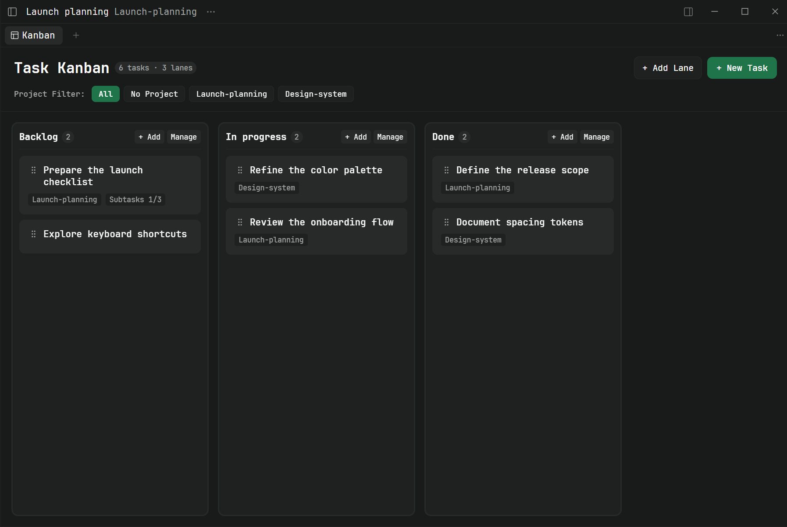
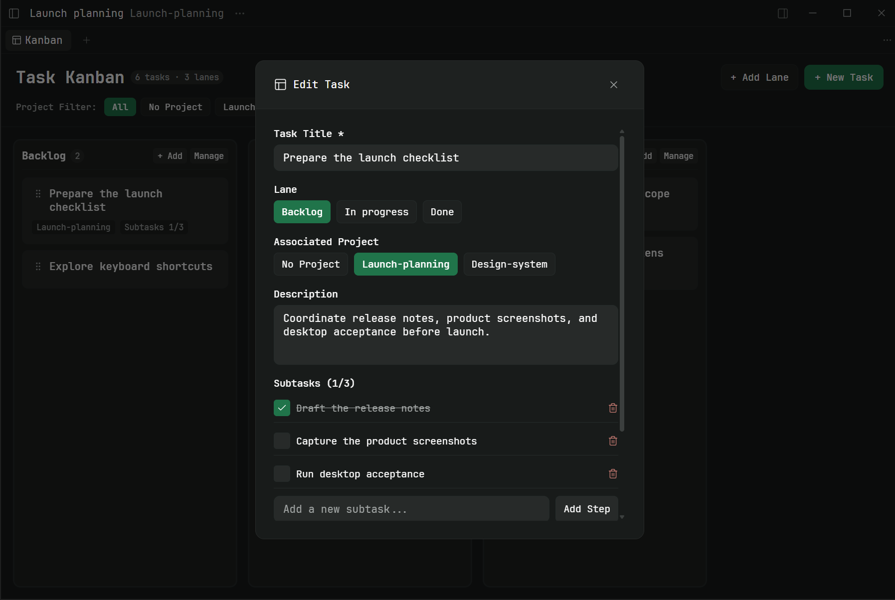
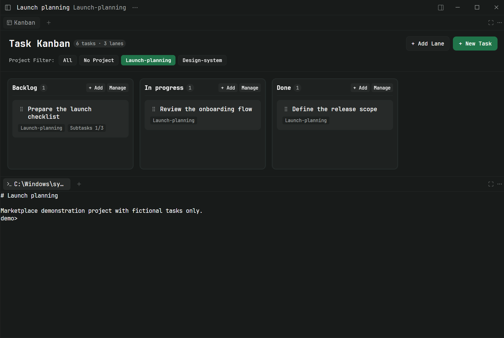

# Paseo Kanban

[简体中文](./README.zh-CN.md)

A Kanban board plugin for [Paseo](https://paseo.sh) workspaces.



---

## Key features

- **Send to Agent**: Send a card's title, description, steps, and source to a new Agent session using a host preset. Select an existing workspace, a new regular workspace, or a new worktree. Agent execution does not update card status.
- **Drag and drop with displacement animation**: Reorder cards within a lane or move cards across lanes. Displays animated slot displacement in the target lane and scrolls automatically near viewport edges.
- **GitHub issue import**: Import open issues from the project repository's GitHub origin into a selected lane using daemon `gh` CLI credentials. Includes pagination, repository-wide creation-time sorting, deduplication, and source links.
- **Completion lane and status restoration**: A dedicated completion lane collects finished tasks. Unchecking or dragging a card out of the completion lane restores it to its original ordinary swimlane without data loss.

---

## General features

- **Task details and subtasks**: Edit task titles and multi-line descriptions with a resizable text box, and track checklist progress with live counters. Right-click a card to edit, move, copy the full prompt, open the source issue, or delete.
- **Swimlane management**: Add, rename, and reorder lanes in a horizontal dialog. Deleting a lane with unfinished tasks requires confirmation to prevent accidental deletion.
- **Project filtering**: Link tasks to Paseo projects and filter cards by project with searchable dropdown lists. Filters are independent per window while sharing the underlying board data.
- **Workspace tabs and splits**: Open the board from the sidebar or beside an agent or terminal with Paseo's native split controls.

---

## Screenshots

### Board overview


### Task details and subtasks checklist



### Workspace tabs and split controls



---

## Requirements

- **Paseo host**: `>= 0.11.4` (declared in `paseo-plugin.json`). The host runs the plugin.
- **GitHub import (optional)**: Install Git and GitHub CLI (`gh`) on the daemon machine, sign in with `gh auth login`, and configure the project repository’s `origin` on GitHub.com. Both public and authorized private repositories are supported.
- **Development and CI**: Node.js 24 (pinned in `.nvmrc` and `.node-version`) for checks, TypeScript stripping, and native tests.

---

## Installation

### Quick install (recommended)

Install using the Paseo CLI:

**From npm:**

```bash
paseo plugin install npm:paseo-kanban
```

**From GitHub:**

```bash
paseo plugin add breathi3552/paseo-kanban
```

To explicitly track the latest updates on the `main` branch:

```bash
paseo plugin add breathi3552/paseo-kanban --ref main
```

Verify that the plugin is running:

```bash
paseo plugin ls
```

Open the board from either entry:

- **Sidebar → Kanban**: shows all tasks by default.
- **Workspace → `+` → Kanban**: initially filters to the workspace's project, with other filters available; use Paseo's native split controls to place it beside an agent or terminal.

### Local development

To contribute or debug locally:

```bash
# 1. Clone repository and install dependencies
git clone https://github.com/breathi3552/paseo-kanban.git
cd paseo-kanban
npm ci

# 2. Link this directory into your local Paseo daemon
paseo plugin link .
```

---

## Development and testing

Install dependencies and run the full quality check:

```bash
npm ci
npm run check
```

Individual commands (`npm test`, `npm run check:portal`, `npm run typecheck`, `npm run lint`, `npm run format:check`, `npm run check:package`) are defined in [`package.json`](./package.json). For tag-based publishing, release sources of truth, recovery, and host acceptance, see the [development guide](./docs/development.md#3-发布流程).

---

## Releases

See the [CHANGELOG](./CHANGELOG.md). Each release's npm package and GitHub Release share the same version tag; GitHub includes the verified npm tarball. `main` may contain changes beyond the latest release.

---

## Architecture and design

Core terminology and design decisions are documented in [`GLOSSARY.md`](./GLOSSARY.md) and [`docs/adr/`](./docs/adr/).

---

## License

MIT
