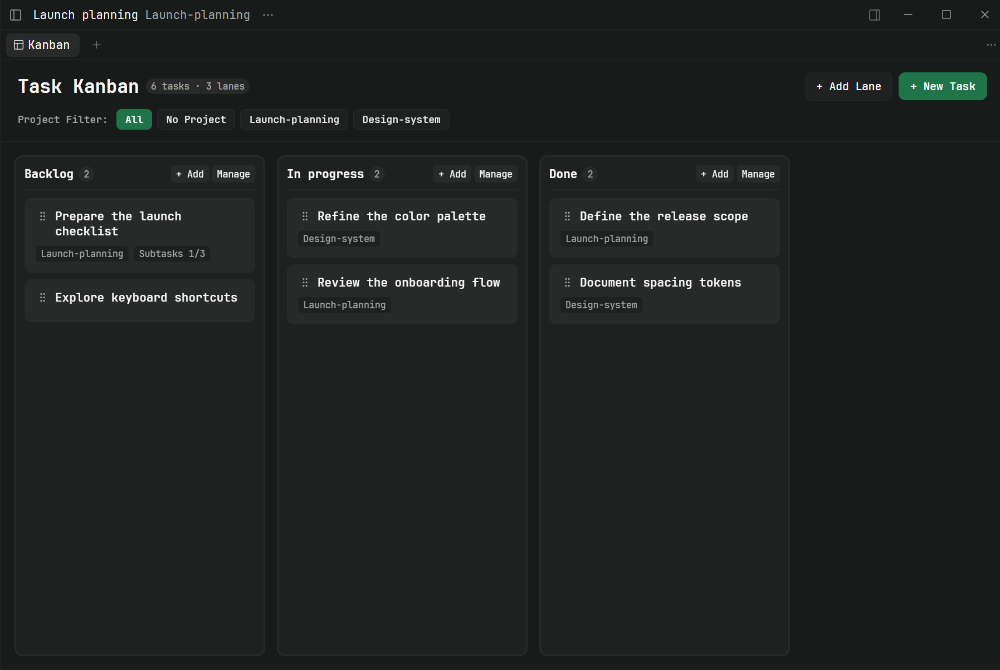
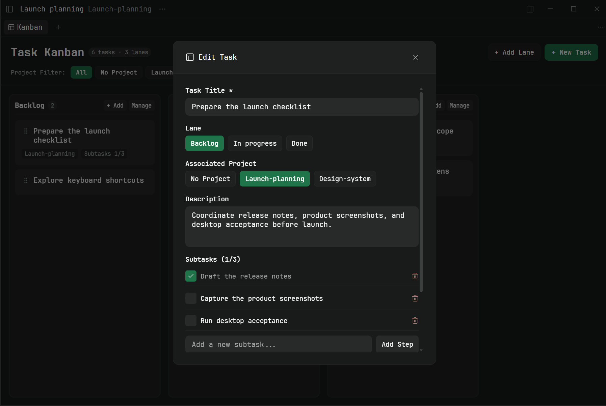
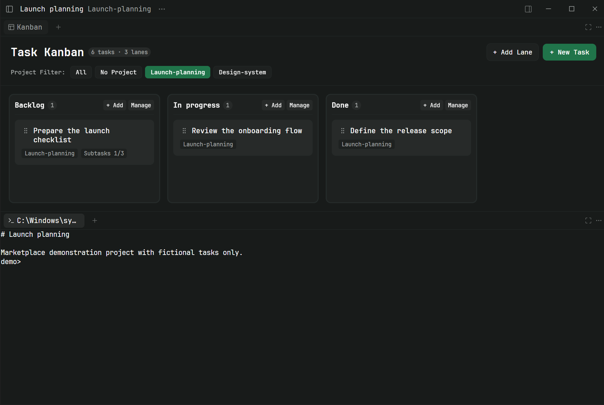

# Paseo 看板插件 (Paseo Kanban)

[English](./README.md)

专为 [Paseo](https://paseo.sh) 工作区打造的轻量响应式看板插件。



---

## 亮点特性

- **泳道管理**：在统一横向弹窗中增删改泳道并立即保存，通过左右按钮或拖动预览排列，再单独保存顺序。含未完成任务的泳道经确认后连同所有项目中的未完成任务删除，已完成任务保留。
- **任务右键菜单**：右键卡片可编辑、移动、完成、复制完整提示词、打开来源 Issue 或确认删除。桌面左键单击不再打开详情；除 checkbox 与发送按钮外，整张卡片均可拖拽。
- **拖拽交互**：流畅的同泳道排序与跨泳道状态流转，支持动态占位槽避让、视口边缘自动滚动与平滑落位动画。
- **发送到 Agent**：在卡片选择宿主预设和已有工作区、新建普通工作区或 worktree，将标题、描述、子步骤及来源直接发送至新 Agent；执行状态不回流看板。
- **GitHub Issue 导入**：从项目关联的 GitHub 仓库单向导入 Open Issues 到指定泳道，具备分页、全仓库创建时间排序、自动去重及来源外链直达能力。

---

## 其他特性

- **丰富的任务卡片**：
  - 任务标题与多行描述编辑（支持多行描述框拖拽调节高度）。
  - 子步骤清单与完成进度实时统计。
  - 支持通过原生下拉选择框将任务关联至 Paseo 中创建的项目。
- **任务完成与恢复**：卡片左侧勾选复选框或拖入专用完成泳道即可标记完成；取消勾选或拖出即可无损恢复至原普通泳道。
- **工作区标签页与分屏**：支持通过 Paseo 原生分屏控件与 Agent、终端任意并排打开，默认自动筛选当前工作区项目，亦可通过侧边栏独立打开。
- **独立项目筛选**：支持通过原生下拉选择框按关联项目快速筛选或查看未关联任务，各打开窗口筛选独立且共享整板底层数据。
- **宿主持久化与并发保护**：看板数据安全保存在宿主设置中，具备版本并发冲突保护（CAS），表单草稿与错误状态受保护不被静默覆盖。

---

## 界面预览

### 看板全景


### 任务详情与子步骤



### 工作区标签页与分屏



---

## 环境要求

- **Paseo 宿主**：`>= 0.11.4`（声明于 `paseo-plugin.json`），由 Paseo 运行插件。
- **GitHub 导入（可选）**：在 daemon 所在机器安装 Git 与 GitHub CLI（`gh`），执行 `gh auth login`，并将项目仓库的 `origin` 配置为 GitHub.com 仓库；支持公开及有权访问的私有仓库。
- **开发与 CI**：使用 Node.js 24（声明于 `.nvmrc` 与 `.node-version`）执行质量检查、TypeScript 类型擦除和原生测试。

---

## 安装

### 快速安装（推荐）

通过 Paseo CLI 从 npm 或 GitHub 安装：

**方式一：通过 NPM 官方包安装（推荐）**

```bash
paseo plugin install npm:paseo-kanban
```

**方式二：直接通过 GitHub 仓库安装**

```bash
paseo plugin add breathi3552/paseo-kanban
```

若需显式跟踪 `main` 分支最新更新：

```bash
paseo plugin add breathi3552/paseo-kanban --ref main
```

安装后可通过以下命令检查运行状态：

```bash
paseo plugin ls
```

可从两个入口打开看板：

- **侧边栏 → 看板**：默认展示全部任务。
- **工作区 → `+` → 看板**：默认筛选工作区所属项目，可切换范围；使用 Paseo 原生分屏操作与 Agent、Terminal 等并排显示。

### 本地开发与调试

如需进行本地源码调试或二次开发：

```bash
# 1. 克隆代码仓库并安装依赖
git clone https://github.com/breathi3552/paseo-kanban.git
cd paseo-kanban
npm ci

# 2. 将当前开发目录软链接至本地 Paseo 守护进程
paseo plugin link .
```

---

## 开发与测试

安装依赖并运行完整检查：

```bash
npm ci
npm run check
```

单项命令（`npm test`、`npm run check:portal`、`npm run typecheck`、`npm run lint`、`npm run format:check`、`npm run check:package`）见 [`package.json`](./package.json)。标签发布、事实来源、失败重试与宿主验收见[开发指南](./docs/development.md#21-标签发布github-actions)。

---

## 版本发布

参见 [更新日志 (CHANGELOG)](./CHANGELOG.md)。每版 npm 包与 GitHub Release 对应同一个版本 tag，GitHub 附带经过验证的 npm tarball。`main` 可能包含最新发布版之后的改动。

---

## 架构设计

核心术语和架构决策见 [`GLOSSARY.md`](./GLOSSARY.md) 与 [`docs/adr/`](./docs/adr/)。

---

## 开源协议

MIT
