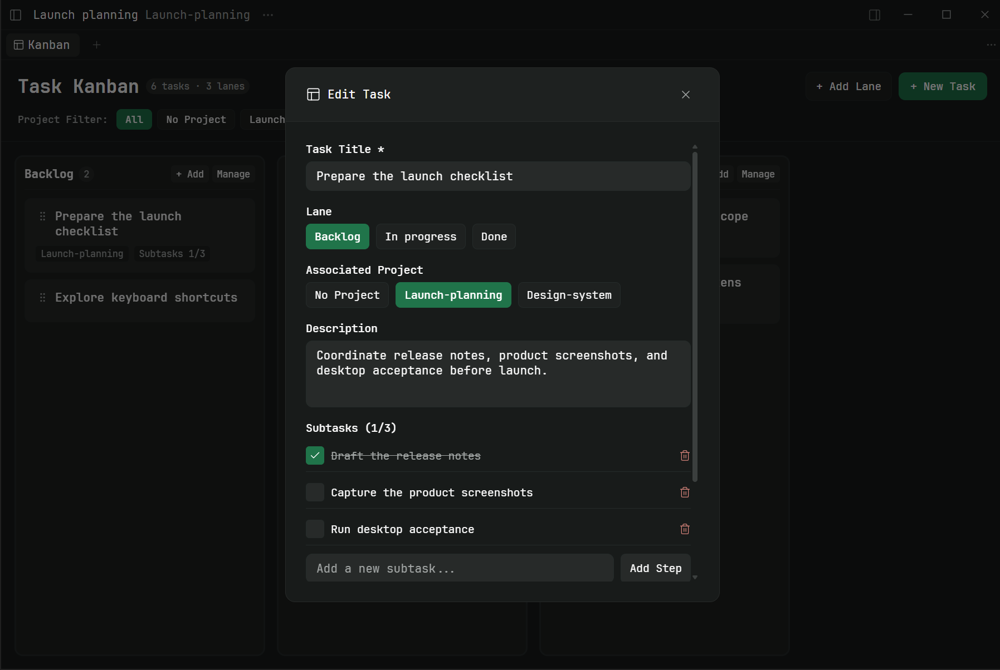

# Paseo 看板插件 (Paseo Kanban)

[English](./README.md)

[Paseo](https://paseo.sh) 工作区的任务看板插件。


---

## 核心特性

- **发送到 Agent**：选择宿主预设并在已有工作区、新建普通工作区或 worktree 中启动新 Agent，直接发送标题、描述、子步骤与来源。Agent 执行状态不回流看板。
- **拖拽交互与位移动画**：支持同泳道拖拽排序与跨泳道移动。移动过程中目标泳道展示平滑的占位槽避让动画，拖拽靠近视口边缘时自动滚动。
- **GitHub Issue 导入**：基于本地 `gh` CLI 登录态，单向导入项目 GitHub 仓库的 Open Issue 到指定泳道。支持分页浏览、全仓库创建时间排序、自动去重与外链直达。
- **完成泳道与状态回弹**：专用完成泳道集中收拢已完成任务。取消勾选或拖出完成泳道时，卡片无损恢复至其原本归属的普通泳道。

---

## 基础功能

- **卡片管理与子步骤**：支持多行描述编辑（可调节输入框高度）、子步骤清单及完成进度统计。右键卡片可快速编辑、流转、复制全量 Prompt、打开来源 Issue 或删除。
- **泳道管理**：在横向弹窗中添加、重命名与调整泳道顺序。删除含有未完成任务的泳道需要二次确认，避免误删。
- **项目关联与检索过滤**：支持将任务关联至 Paseo 项目，并按项目快速筛选任务（长列表支持实时搜索）；各窗口独立维护筛选状态。
- **工作区分屏展示**：支持从侧边栏打开全局看板，也支持在工作区标签页内通过 Paseo 原生分屏控件与 Agent、终端并排展示。

---

## 界面预览

### 看板全景


### 任务详情与子步骤



### 工作区标签页与分屏


---

## 环境要求

- **Paseo 宿主**：`>= 0.11.4`（声明于 `paseo-plugin.json`）。
- **GitHub 导入（可选）**：在 daemon 所在机器安装 Git 与 GitHub CLI（`gh`），执行 `gh auth login`，并将项目仓库的 `origin` 配置为 GitHub.com 仓库。支持公开仓库与有权访问的私有仓库。
- **开发与 CI**：使用 Node.js 24（声明于 `.nvmrc` 与 `.node-version`）执行质量检查、TypeScript 类型擦除和原生测试。

---

## 安装

### 快速安装（推荐）

通过 Paseo CLI 从 npm 或 GitHub 安装：

**方式一：通过 NPM 官方包安装（推荐）**

```bash
paseo plugin install npm:paseo-kanban
```

**方式二：直接通过 GitHub 仓库安装**

```bash
paseo plugin add breathi3552/paseo-kanban
```

若需显式跟踪 `main` 分支最新更新：

```bash
paseo plugin add breathi3552/paseo-kanban --ref main
```

安装后可通过以下命令检查运行状态：

```bash
paseo plugin ls
```

可从两个入口打开看板：

- **侧边栏 → 看板**：默认展示全部任务。
- **工作区 → `+` → 看板**：默认筛选工作区所属项目，可切换范围；使用 Paseo 原生分屏操作与 Agent、Terminal 等并排显示。

### 本地开发与调试

如需进行本地源码调试或二次开发：

```bash
# 1. 克隆代码仓库并安装依赖
git clone https://github.com/breathi3552/paseo-kanban.git
cd paseo-kanban
npm ci

# 2. 将当前开发目录软链接至本地 Paseo 守护进程
paseo plugin link .
```

---

## 开发与测试

安装依赖并运行完整检查：

```bash
npm ci
npm run check
```

单项命令（`npm test`、`npm run check:portal`、`npm run typecheck`、`npm run lint`、`npm run format:check`、`npm run check:package`）见 [`package.json`](./package.json)。标签发布、事实来源、失败重试与宿主验收见[开发指南](./docs/development.md#3-发布流程)。

---

## 版本发布

参见 [更新日志 (CHANGELOG)](./CHANGELOG.md)。每版 npm 包与 GitHub Release 对应同一个版本 tag，GitHub 附带经过验证的 npm tarball。`main` 可能包含最新发布版之后的改动。

---

## 架构设计

核心术语和架构决策见 [`GLOSSARY.md`](./GLOSSARY.md) 与 [`docs/adr/`](./docs/adr/)。

---

## 开源协议

MIT
